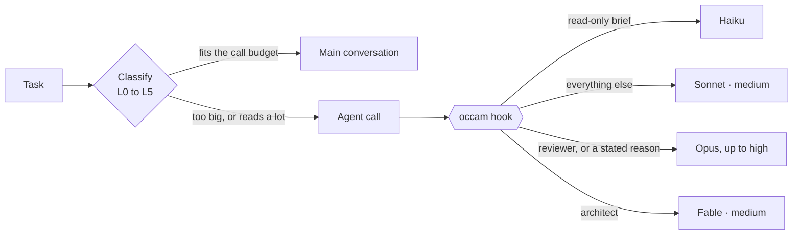

# occam

**Occam's razor for Claude Code.** No bigger model than the task needs, and no bigger model without a stated reason.

> Haiku when a haiku will do.

[](https://github.com/romulorgc/occam/actions/workflows/test.yml)


[Português](README.pt-BR.md)

Claude Code will happily spend your most expensive model, at the highest effort, on renaming a file. `occam` is a skill plus a hook that stops that:

- **Classifies** every task into six levels (L0 to L5) before the first tool call.
- **Routes** each delegated task to the cheapest model and effort that can do it: Haiku 5.5, Sonnet 5.5, Opus 5.5 or Fable 5.2.
- **Enforces** the choice on every `Agent` call. Want Opus for a refactor? Write the reason in the brief: `[opus: touches billing]`. No reason, no Opus.
- **Budgets** the main conversation: every prompt shows the context size, what each tool call costs there and how many calls it gets before it should delegate.
- **Guides compaction**, so the summary keeps decisions and proof and drops raw tool output.
- **Measures** what you spent, per thread and per model, from your local transcripts.

Zero dependencies. The hook is one Node file. It reads briefs written in English or Portuguese.

## Why

Two facts drive the whole design.

**1. In the main conversation, the expensive thing is context, not the model.** Every tool call there re-reads the entire conversation, and everything that enters stays and gets re-read until compaction. A subagent starts clean. When I measured my own transcripts before building this, 59% of the spend was the main thread re-reading its own context, and Haiku did 0.2% of the work.

**2. Models pick expensive, and nobody asks why.** In 561 real delegations, the model left the `model` field empty exactly zero times. It always chose, and it chose high. Filling in defaults does nothing. What works is checking the choice and asking for the reason.

The thresholds come from Anthropic's guide, [Which Claude model should you build with?](https://claude.dev/blog/which-claude-model-should-you-build-with/):

- Opus 5.5 at medium effort lands about 2.5 points below high, for 70% of the cost.
- xhigh buys 1.4 points for 2.5 times the cost of high.
- Fable 5.2 at high matches Opus 5.5 at max for about half the cost.

So Opus never goes past high here. The next step up is Fable at medium.

## The ladder

| Level | The task is | Agent | Model · effort |
| --- | --- | --- | --- |
| L0 | Format, convert, rename. No search | general-purpose | haiku · low |
| L1 | Locate, list, count, extract a literal fact, summarize | scout | haiku · medium |
| L2 | Understand code, apply a decided pattern across files, write tests for defined behavior, mechanical refactor | general-purpose | sonnet · medium |
| L3 | Debug an unknown cause, second attempt, synthesize research | general-purpose | sonnet · high, with `[high: reason]` |
| L4 | Review a diff before it ships | reviewer | sonnet · high (opus for money, security or auth) |
| L5 | Architecture, real trade-offs, a bug that survived two attempts, data migration, race conditions | architect | fable · medium |

Climb only on verified failure, in this order:

1. Did the executor have a way to check its own work (a test, a build, a script)? If not, give it one and retry.
2. Raise the effort one step.
3. Raise the model, starting at the lower effort.

Never start on the expensive rung "just in case". The reviewer and the tests catch what slips through, and those are never downgraded.

## What the hook does to an `Agent` call



| You send | The hook does | Keep your choice with |
| --- | --- | --- |
| No `model` or `effort` on the architect | Fills fable · medium | |
| No `model` or `effort` on general-purpose, Plan or claude | Fills sonnet · medium, or haiku · medium when the brief is read-only. Explore always gets Haiku | |
| Sonnet up to medium on a scout or Explore, or on general-purpose or claude with a read-only brief | Swaps to Haiku | `[sonnet: reason]` |
| Opus outside reviewer and architect | Swaps to Sonnet | `[opus: reason]` |
| Fable outside architect | Swaps to Opus on the reviewer, to Sonnet elsewhere | `[fable: reason]` |
| `high` on general-purpose, implementer, scout or Explore | Lowers to medium | `[high: reason]` |
| `xhigh` or `max` | Kept on the architect, where Opus at that effort becomes fable · high. Capped at high on the reviewer. On the agents of the row above: high with `[high: reason]`, medium without | |

Agents that are not listed keep what their own definition says, and every list here is configurable. Every swap is reported back to the main conversation and written to a local log, so nothing changes silently.

What it looks like, copied from a real run. This line is added to every prompt (cut here, it goes on):

```text
[occam] context ≈ 146K (fable-5-2) · each tool call here rereads ≈ $0.029 · call budget here: 3 calls, beyond that delegate · …
```

And this is what comes back when a delegation goes out:

```text
# Opus at high effort for a rename, with no reason given
[occam · swapped] The hook changed this delegation: model opus became sonnet (no [opus: reason] marker for opus); effort high became medium (no [high: reason] marker for high). Markers in the brief: [opus: reason], [fable: reason], [high: reason], [sonnet: reason].

# "List every file that imports the billing client, as path:line. Do not edit anything." sent to Sonnet
[occam · swapped] The hook changed this delegation: model sonnet became haiku (read-only brief; to keep it, add a [sonnet: reason] marker). Markers in the brief: [opus: reason], [fable: reason], [high: reason], [sonnet: reason].

# The architect, with no model chosen
[occam] The hook filled in this delegation: architect · fable · medium.

# "Refactor the invoice rounding. [opus: touches billing math]"
(silence: the reason is there, so Opus goes through)
```

The log keeps the agent type, the model, the effort and what changed. It never stores the text of your brief.

A brief counts as read-only when its objective opens with a reading verb (locate, list, count, extract, summarize, search, find), asks for no judgment (analyze, review, compare, why, root cause, prove, explain) and nothing in the brief asks for writing or web research. "Do not edit anything" does not count as asking for an edit. Only answers you can check mechanically, such as `path:line`, a count or a list, go to Haiku.

## Install

```bash
git clone https://github.com/romulorgc/occam
cd occam
node install.mjs                # add --with-agents for the scout, reviewer and architect agents
```

Restart Claude Code. That is all.

- The installer copies the hook and the skill into `~/.claude`, registers four hook events in `settings.json` and backs the file up first.
- It never overwrites an agent you already have.
- `node install.mjs --dry-run` shows the plan without writing. `node install.mjs --uninstall` removes the hook, the skill and their entries in `settings.json`. It keeps your log and config in `~/.claude/occam/`, the agents and the settings backups.
- Prefer doing it by hand? Copy the block in [`examples/settings.hooks.json`](examples/settings.hooks.json).

Requires Node 18 or newer and a recent Claude Code (PreToolUse hooks that can rewrite tool input, and the PreCompact event). Built against Claude Code 2.1.

## Measure

Ask Claude Code for `/occam measure`, or run it yourself:

```bash
node ~/.claude/skills/occam/scripts/measure.mjs 7
```

You get the API-equivalent cost of the last 7 days by thread and model, the average context per response, every delegation the hook saw and every swap it made. It reads only token counts and model names from your local transcripts. Nothing leaves your machine.

Two more scripts help you tune the classifier against your own history: `replay.mjs` runs your real past delegations through the hook in a sandbox and shows what it would have changed, and `calibrate.mjs` shows which briefs count as read-only and which word blocked the others.

## Configure

Everything has a default and nothing needs configuring. To use your own agent names, prices or call budget, create `~/.claude/occam/config.json`. See [docs/CONFIG.md](docs/CONFIG.md).

## What to expect, honestly

- **The Haiku floor is a safety net, not the main saving.** When I calibrated the classifier on 365 real briefs, exactly one was a pure reading task sent to Sonnet. The big wins are the main conversation delegating its reading instead of doing it in the expensive context, and the end of "Opus just in case" and "high just in case".
- **It cuts waste, never quality.** Review and tests stay on strong models. Anything headed for production still gets reviewed.
- **Costs are estimates** from public list prices. On a subscription, read them as a proxy for how fast you burn quota.
- **It does not change your main model** and it does not write to `settings.json` beyond registering itself, unless you opt in with `capStoredEffort`.
- **It approves the call it rewrites.** To change the model or the effort, the hook returns the call with `permissionDecision: "allow"`, which is how a Claude Code hook rewrites tool input. That skips the default permission prompt for the Agent tool. Deny and ask rules in your settings are still evaluated. To see every rewritten call before it runs, set `permission` to `ask` in the config.
- **You are always in charge.** One marker in the brief overrides any swap.

## FAQ

**Does it slow Claude Code down?** The hook is a single Node process per event with no network calls.

**Does it work with my own agents?** Yes. Map your agent names in the config.

**My briefs are not in English.** The classifier reads English and Portuguese. Other languages fall back to the safe side: no swap to Haiku.

**Can I turn off one rule?** Yes, through the config. Empty `highNeedsReason`, `floorTypes`, `floorByBrief` or `fillDefaults`, or set `topTier` to `null`. `opusFree` and `fableFree` work the other way around: they list who may use the model without a reason, so you relax those rules by adding your agents to them.

## Credits and license

The thresholds follow Anthropic's public model guide linked above. This project is not affiliated with or endorsed by Anthropic.

MIT. See [LICENSE](LICENSE).
