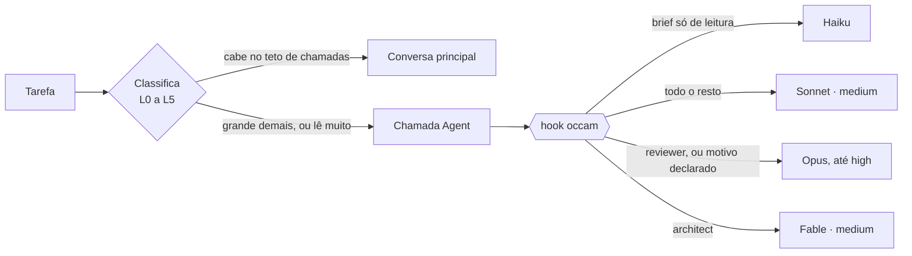

# occam

**A navalha de Occam para o Claude Code.** Nenhum modelo maior do que a tarefa pede, e nenhum modelo maior sem motivo declarado.

> Haiku quando um haiku resolve.

[](https://github.com/romulorgc/occam/actions/workflows/test.yml)


[English](README.md)

O Claude Code gasta sem cerimônia o seu modelo mais caro, no esforço mais alto, para renomear um arquivo. O `occam` é uma skill mais um hook que acabam com isso:

- **Classifica** toda tarefa em seis níveis (L0 a L5) antes da primeira ferramenta.
- **Encaminha** cada tarefa delegada ao modelo e ao esforço mais baratos que dão conta: Haiku 5.5, Sonnet 5.5, Opus 5.5 ou Fable 5.2.
- **Cobra** a escolha em toda chamada `Agent`. Quer Opus num refactor? Escreva o motivo no brief: `[opus: touches billing]`. Sem motivo, sem Opus.
- **Dá um teto** à conversa principal: todo pedido mostra o tamanho do contexto, quanto custa cada chamada de ferramenta ali e quantas ela tem antes de delegar.
- **Orienta a compactação**, para o resumo guardar decisões e provas e descartar saída bruta de ferramenta.
- **Mede** o que você gastou, por thread e por modelo, a partir dos seus transcritos locais.

Zero dependências. O hook é um arquivo Node só. Ele lê briefs escritos em inglês ou em português.

## Por quê

Dois fatos sustentam o desenho inteiro.

**1. Na conversa principal, o caro é o contexto, não o modelo.** Cada chamada de ferramenta ali relê a conversa inteira, e tudo o que entra fica sendo relido até a compactação. Subagente começa limpo. Quando medi os meus próprios transcritos antes de construir isto, 59% do gasto era a conversa principal relendo o próprio contexto, e o Haiku fazia 0,2% do trabalho.

**2. O modelo escolhe caro, e ninguém pergunta por quê.** Em 561 delegações reais, o modelo deixou o campo `model` vazio exatamente zero vezes. Ele sempre escolheu, e escolheu alto. Preencher padrão não muda nada. O que funciona é conferir a escolha e pedir o motivo.

Os limiares vêm do guia da Anthropic, [Which Claude model should you build with?](https://claude.dev/blog/which-claude-model-should-you-build-with/):

- Opus 5.5 em esforço medium fica cerca de 2,5 pontos abaixo do high, por 70% do custo.
- xhigh compra 1,4 ponto por 2,5 vezes o custo do high.
- Fable 5.2 em high empata com Opus 5.5 em max por cerca de metade do custo.

Por isso o Opus nunca passa de high aqui. O degrau seguinte é o Fable em medium.

## A escada

| Nível | A tarefa é | Agente | Modelo · esforço |
| --- | --- | --- | --- |
| L0 | Formatar, converter, renomear. Sem busca | general-purpose | haiku · low |
| L1 | Localizar, listar, contar, extrair fato literal, resumir | scout | haiku · medium |
| L2 | Entender código, aplicar um padrão já decidido em vários arquivos, escrever testes de comportamento definido, refactor mecânico | general-purpose | sonnet · medium |
| L3 | Depurar causa desconhecida, segunda tentativa, sintetizar pesquisa | general-purpose | sonnet · high, com `[high: reason]` |
| L4 | Revisar um diff antes de publicar | reviewer | sonnet · high (opus para dinheiro, segurança ou autenticação) |
| L5 | Arquitetura, trade-off real, bug que resistiu a duas tentativas, migração de dados, race condition | architect | fable · medium |

Suba só na falha verificada, nesta ordem:

1. O executor tinha como conferir o próprio trabalho (um teste, um build, um script)? Se não, dê isso a ele e repita.
2. Suba o esforço um degrau.
3. Suba o modelo, começando no esforço menor.

Nunca comece no degrau caro "por garantia". O revisor e os testes pegam o que passar, e esses nunca são rebaixados.

## O que o hook faz com uma chamada `Agent`



| Você manda | O hook faz | Mantenha a sua escolha com |
| --- | --- | --- |
| Sem `model` ou `effort` no architect | Preenche fable · medium | |
| Sem `model` ou `effort` em general-purpose, Plan ou claude | Preenche sonnet · medium, ou haiku · medium quando o brief é só de leitura. Explore recebe sempre Haiku | |
| Sonnet até medium num scout ou Explore, ou em general-purpose ou claude com brief só de leitura | Troca por Haiku | `[sonnet: reason]` |
| Opus fora de reviewer e architect | Troca por Sonnet | `[opus: reason]` |
| Fable fora de architect | Troca por Opus no reviewer, por Sonnet nos demais | `[fable: reason]` |
| `high` em general-purpose, implementer, scout ou Explore | Baixa para medium | `[high: reason]` |
| `xhigh` ou `max` | Mantido no architect, onde Opus nesse esforço vira fable · high. Limitado a high no reviewer. Nos agentes da linha de cima: high com `[high: reason]`, medium sem | |

Agente que não está na lista fica com o que a própria definição dele diz, e toda lista aqui é configurável. Toda troca volta para a conversa principal e fica num registro local, então nada muda em silêncio.

Como fica, copiado de uma execução real (o hook e a skill falam inglês; o classificador entende brief em português). Esta linha entra em todo pedido (cortada aqui, ela continua):

```text
[occam] context ≈ 146K (fable-5-2) · each tool call here rereads ≈ $0.029 · call budget here: 3 calls, beyond that delegate · …
```

E isto é o que volta quando sai uma delegação:

```text
# Opus em esforço high para renomear, sem motivo declarado
[occam · swapped] The hook changed this delegation: model opus became sonnet (no [opus: reason] marker for opus); effort high became medium (no [high: reason] marker for high). Markers in the brief: [opus: reason], [fable: reason], [high: reason], [sonnet: reason].

# "List every file that imports the billing client, as path:line. Do not edit anything." mandado ao Sonnet
[occam · swapped] The hook changed this delegation: model sonnet became haiku (read-only brief; to keep it, add a [sonnet: reason] marker). Markers in the brief: [opus: reason], [fable: reason], [high: reason], [sonnet: reason].

# O architect, sem modelo escolhido
[occam] The hook filled in this delegation: architect · fable · medium.

# "Refatorar o arredondamento da fatura. [opus: mexe em cobrança]"
(silêncio: o motivo está lá, então o Opus passa)
```

O registro guarda o tipo de agente, o modelo, o esforço e o que mudou. Nunca guarda o texto do seu brief.

Um brief conta como só de leitura quando o objetivo abre com um verbo de leitura (localizar, listar, contar, extrair, resumir, procurar, achar), não pede julgamento (analisar, revisar, comparar, por que, causa raiz, provar, explicar) e nada no brief pede escrita ou pesquisa na web. "Não edite nada" não conta como pedido de edição. Só vai para o Haiku o que volta conferível de forma mecânica: `caminho:linha`, uma contagem, uma lista.

## Instalar

```bash
git clone https://github.com/romulorgc/occam
cd occam
node install.mjs                # use --with-agents para instalar os agentes scout, reviewer e architect
```

Reinicie o Claude Code. É só isso.

- O instalador copia o hook e a skill para `~/.claude`, registra quatro eventos de hook no `settings.json` e faz backup do arquivo antes.
- Ele nunca sobrescreve um agente que você já tem.
- `node install.mjs --dry-run` mostra o plano sem escrever. `node install.mjs --uninstall` remove o hook, a skill e as entradas deles no `settings.json`. Ficam o seu registro e a sua configuração em `~/.claude/occam/`, os agentes e os backups do settings.
- Prefere fazer à mão? Copie o bloco de [`examples/settings.hooks.json`](examples/settings.hooks.json).

Pede Node 18 ou mais novo e um Claude Code recente (hook PreToolUse que reescreve a entrada da ferramenta, e o evento PreCompact). Feito sobre o Claude Code 2.1.

## Medir

Peça `/occam measure` ao Claude Code, ou rode você mesmo:

```bash
node ~/.claude/skills/occam/scripts/measure.mjs 7
```

Sai o custo equivalente de API dos últimos 7 dias por thread e por modelo, o contexto médio por resposta, cada delegação que o hook viu e cada troca que ele fez. Ele lê só contagem de tokens e nome de modelo dos seus transcritos locais. Nada sai da sua máquina.

Outros dois scripts ajudam a afinar o classificador com o seu próprio histórico: o `replay.mjs` passa as suas delegações reais pelo hook numa pasta isolada e mostra o que ele teria mudado, e o `calibrate.mjs` mostra quais briefs contam como só de leitura e que palavra barrou os outros.

## Configurar

Tudo tem padrão e nada precisa de configuração. Para usar os seus nomes de agente, os seus preços ou o seu teto de chamadas, crie `~/.claude/occam/config.json`. Veja [docs/CONFIG.md](docs/CONFIG.md).

## O que esperar, sem enfeite

- **O piso Haiku é rede de proteção, não a economia principal.** Quando calibrei o classificador em 365 briefs reais, exatamente um era leitura pura mandada ao Sonnet. O ganho grande está na conversa principal delegar a leitura em vez de fazê-la no contexto caro, e no fim do "Opus por garantia" e do "high por garantia".
- **Corta desperdício, nunca qualidade.** Revisão e testes continuam em modelo forte. O que vai para produção continua sendo revisado.
- **Os custos são estimativas** pelos preços públicos de tabela. Em assinatura, leia como um indicador de quão rápido a sua cota vai embora.
- **Não troca o seu modelo principal** e não escreve no `settings.json` além de se registrar, a menos que você ligue `capStoredEffort`.
- **Ele aprova a chamada que reescreve.** Para trocar o modelo ou o esforço, o hook devolve a chamada com `permissionDecision: "allow"`, que é como um hook do Claude Code reescreve a entrada de uma ferramenta. Isso pula o pedido de permissão padrão da ferramenta Agent. As regras de deny e ask do seu settings continuam sendo avaliadas. Para ver cada chamada reescrita antes de ela rodar, ponha `permission` em `ask` na configuração.
- **Quem manda é você.** Um marcador no brief vence qualquer troca.

## Perguntas

**Deixa o Claude Code mais lento?** O hook é um processo Node por evento, sem chamada de rede.

**Funciona com os meus agentes?** Sim. Mapeie os nomes na configuração.

**Meus briefs não são em inglês.** O classificador lê inglês e português. Em outra língua ele fica do lado seguro: não troca por Haiku.

**Dá para desligar uma regra?** Sim, pela configuração. Esvazie `highNeedsReason`, `floorTypes`, `floorByBrief` ou `fillDefaults`, ou ponha `topTier` em `null`. `opusFree` e `fableFree` funcionam ao contrário: listam quem pode usar o modelo sem motivo, então a regra afrouxa quando você põe os seus agentes nelas.

## Créditos e licença

Os limiares seguem o guia público de modelos da Anthropic citado acima. Este projeto não é afiliado à Anthropic nem endossado por ela.

MIT. Veja [LICENSE](LICENSE).
